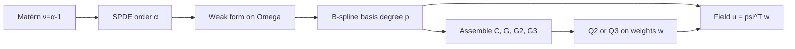

# Methods: FEM Matérn GRF with tensor-product B-splines (α = 2 and α = 3)

This plan has three parts: **methods** (§1–5) for the SPDE / FEM weight precision; **package `adlaplaceGrf`** (§6) for sparse \(\mathbf{A},\mathbf{C},\mathbf{G},\mathbf{G}_2,\mathbf{G}_3\); and **adlaplace kernels** `random_fem_2` / `random_fem_3` (§7) plus two vignettes (§8: joint density AD check; methods + Matérn vs FEM comparison). Optimization / `fit` comes later.

**Locked choices for this write-up:**

- Operator orders **α = 2** and **α = 3** in **d = 2** (smoothness **ν = α − 1**, so **ν = 1** and **ν = 2**)
- Rectangular domain, regular knot grid, **higher-order** tensor-product B-splines
- Weight precision from **local differential Grams** (no mass lumping, no dense `C⁻¹` factors in the working formulas)
- Recommended spline degrees: **p = 2** when α = 2; **p = 3** when α = 3
- Homogeneous Neumann boundary conditions as in the standard SPDE–FEM literature

---

## 1. Continuous model: Matérn via Whittle SPDE

A zero-mean Gaussian field \(u(\mathbf{s})\) on \(\mathbb{R}^d\) with Matérn covariance

\[
\operatorname{Cov}\bigl(u(\mathbf{s}),u(\mathbf{s}')\bigr)
=
\frac{\sigma^2}{2^{\nu-1}\Gamma(\nu)}
(\kappa\|\mathbf{h}\|)^\nu K_\nu(\kappa\|\mathbf{h}\|),
\quad \mathbf{h}=\mathbf{s}-\mathbf{s}',
\]

is (under mild conditions) a stationary solution of

\[
\tau\,(\kappa^2-\Delta)^{\alpha/2}\,u(\mathbf{s})=\mathcal{W}(\mathbf{s}),
\qquad \alpha=\nu+d/2,
\]

with Gaussian white noise \(\mathcal{W}\) (Whittle; Lindgren, Rue & Lindström 2011). The continuous precision operator is \(\tau^2(\kappa^2-\Delta)^\alpha\).

**Cases in this plan** (\(d=2\)):

| α | ν | SPDE | Precision operator |
|---|----|------|--------------------|
| 2 | 1 | \(\tau(\kappa^2-\Delta)u=\mathcal{W}\) | \(\tau^2(\kappa^2-\Delta)^2=\tau^2(\kappa^4-2\kappa^2\Delta+\Delta^2)\) |
| 3 | 2 | \(\tau(\kappa^2-\Delta)^{3/2}u=\mathcal{W}\) | \(\tau^2(\kappa^2-\Delta)^3=\tau^2(\kappa^6-3\kappa^4\Delta+3\kappa^2\Delta^2-\Delta^3)\) |

Expanding these operators into local bilinear forms is the continuous source of the discrete Grams \(\mathbf{C}\), \(\mathbf{G}\), \(\mathbf{G}_2\), and (for α = 3) \(\mathbf{G}_3\) below.

On a bounded domain \(\Omega\subset\mathbb{R}^2\), the SPDE is interpreted in weak form with homogeneous Neumann boundary conditions. That induces boundary artifacts; practice is to pad the domain by roughly half a correlation range.

---

## 2. Finite-element representation and the weight vector

Choose a finite basis \(\{\psi_j\}_{j=1}^N\) and write

\[
\widetilde{u}(\mathbf{s})=\sum_{j=1}^N \psi_j(\mathbf{s})\,w_j=\boldsymbol{\psi}(\mathbf{s})^\top\mathbf{w}.
\]

Galerkin / weak testing produces a Gaussian law for \(\mathbf{w}\) with precision built from local Grams:

| Matrix | Entries | Continuous role |
|--------|---------|-----------------|
| Mass \(\mathbf{C}\) | \(C_{ij}=\langle\psi_i,\psi_j\rangle\) | identity / \(\kappa^{2\alpha}\) term |
| Stiffness \(\mathbf{G}\) | \(G_{ij}=\langle\nabla\psi_i,\nabla\psi_j\rangle\) | weak \(-\Delta\) |
| Biharmonic \(\mathbf{G}_2\) | \((G_2)_{ij}=\langle\Delta\psi_i,\Delta\psi_j\rangle\) | \(\Delta^2\) |
| Third-order \(\mathbf{G}_3\) | \((G_3)_{ij}=\langle\nabla\Delta\psi_i,\nabla\Delta\psi_j\rangle\) | weak \(-\Delta^3\) |

Green’s identities under Neumann BC turn powers of \(-\Delta\) into these gradient / Laplacian products. Required differentiability of \(\psi_j\) increases with α (see spline-degree recommendations in §3).

### Precision of \(\mathbf{w}\) for α = 2

**Working formula** (higher-order bases; sparse):

\[
\mathbf{Q}_2(\kappa,\tau)=\tau^2\bigl(\kappa^4\mathbf{C}+2\kappa^2\mathbf{G}+\mathbf{G}_2\bigr),
\qquad
(G_2)_{ij}=\langle\Delta\psi_i,\Delta\psi_j\rangle.
\]

This replaces the classical Galerkin expression

\[
\tau^2\,(\kappa^2\mathbf{C}+\mathbf{G})\,\mathbf{C}^{-1}\,(\kappa^2\mathbf{C}+\mathbf{G})
=\tau^2\bigl(\kappa^4\mathbf{C}+2\kappa^2\mathbf{G}+\mathbf{G}\mathbf{C}^{-1}\mathbf{G}\bigr),
\]

which is dense because of \(\mathbf{C}^{-1}\). Using \(\mathbf{G}_2\) in place of \(\mathbf{G}\mathbf{C}^{-1}\mathbf{G}\) keeps \(\mathbf{Q}_2\) sparse (Lindgren, Bolin & Rue 2022; Liu, Guillas & Lai 2016).

### Precision of \(\mathbf{w}\) for α = 3

**Working formula** (higher-order bases; sparse), from expanding \((\kappa^2-\Delta)^3\):

\[
\mathbf{Q}_3(\kappa,\tau)=\tau^2\bigl(\kappa^6\mathbf{C}+3\kappa^4\mathbf{G}+3\kappa^2\mathbf{G}_2+\mathbf{G}_3\bigr),
\]

with

\[
(G_2)_{ij}=\langle\Delta\psi_i,\Delta\psi_j\rangle,
\qquad
(G_3)_{ij}=\langle\nabla\Delta\psi_i,\nabla\Delta\psi_j\rangle.
\]

(The \(\mathbf{G}_3\) form is the natural weak realization of \(-\Delta^3\) after integration by parts, parallel to using \(\mathbf{G}\) for \(-\Delta\).)

**Classical recursive contrast** (not used as the working formula here): with \(\mathbf{K}=\kappa^2\mathbf{C}+\mathbf{G}\),

\[
\mathbf{Q}_1=\tau^2\mathbf{K},\qquad
\mathbf{Q}_2=\tau^2\mathbf{K}\mathbf{C}^{-1}\mathbf{K},\qquad
\mathbf{Q}_3=\tau^2\mathbf{K}\mathbf{C}^{-1}\mathbf{K}\mathbf{C}^{-1}\mathbf{K},
\]

or equivalently \(\mathbf{Q}_\alpha=\mathbf{K}\mathbf{C}^{-1}\mathbf{Q}_{\alpha-2}\mathbf{C}^{-1}\mathbf{K}\) for \(\alpha\ge 3\). Those expressions inherit dense \(\mathbf{C}^{-1}\) factors; the Gram expansions \(\mathbf{Q}_2\) and \(\mathbf{Q}_3\) above are the sparse higher-order-B-spline analogues.

In both cases \(\mathbf{w}\sim\mathrm{N}(\mathbf{0},\mathbf{Q}_\alpha^{-1})\). Observations at \(\mathbf{s}_i\) enter through \(A_{ij}=\psi_j(\mathbf{s}_i)\), so field values are \(\mathbf{A}\mathbf{w}\). Hierarchical random effects are the weights \(\mathbf{w}\).



---

## 3. Tensor-product B-splines and recommended degree

On a rectangle \(\Omega=[a_x,b_x]\times[a_y,b_y]\) with regular knot sequences, take 1D B-spline bases \(\{B_i^{(x)}\}_{i=1}^{n_x}\) and \(\{B_j^{(y)}\}_{j=1}^{n_y}\) of common degree \(p\), and set

\[
\psi_{ij}(x,y)=B_i^{(x)}(x)\,B_j^{(y)}(y).
\]

Order coefficients as \(\mathbf{w}=\operatorname{vec}(W)\) with \(W\in\mathbb{R}^{n_x\times n_y}\).

### Recommended order \(p\) by α

Degree must be high enough that the highest Gram in \(\mathbf{Q}_\alpha\) has factors in \(L^2\):

| α | Highest Gram | Derivative order needed | Minimum \(p\) | **Recommended \(p\)** |
|---|--------------|-------------------------|---------------|------------------------|
| 2 | \(\mathbf{G}_2=\langle\Delta\psi,\Delta\phi\rangle\) | 2nd | 2 | **2 (quadratic)** |
| 3 | \(\mathbf{G}_3=\langle\nabla\Delta\psi,\nabla\Delta\phi\rangle\) | 3rd | 3 | **3 (cubic)** |

**Rationale:** B-splines of degree \(p\) have piecewise polynomial derivatives of order \(p\) that are discontinuous but still in \(L^2\). So \(p=2\) is the smallest degree that makes \(\Delta\psi\in L^2\) (needed for \(\mathbf{G}_2\)); \(p=3\) is the smallest that makes \(\nabla\Delta\psi\in L^2\) (needed for \(\mathbf{G}_3\)). Matching \(p=\alpha\) keeps the basis as local as possible while supporting the precision expansion. Using \(p>\alpha\) is valid but widens bandwidth and is not needed for the methods construction.

### Kronecker assembly

With \(\Delta=\partial_{xx}+\partial_{yy}\),

\[
\begin{aligned}
\mathbf{C}&=\mathbf{C}_x\otimes\mathbf{C}_y,\\
\mathbf{G}&=\mathbf{G}_x\otimes\mathbf{C}_y+\mathbf{C}_x\otimes\mathbf{G}_y,\\
\mathbf{G}_2&=\mathbf{G}_{2,x}\otimes\mathbf{C}_y
+\mathbf{C}_x\otimes\mathbf{G}_{2,y}
+2\,\mathbf{G}_x\otimes\mathbf{G}_y.
\end{aligned}
\]

\(\mathbf{G}_3\) likewise expands into Kronecker products of 1D Grams involving third derivatives / mixed \(\partial_{xxx}\), \(\partial_{xyy}\), etc.; the methods write-up should state the expanded identity once from

\[
(G_3)_{ij,kl}=\langle\nabla\Delta\psi_{ij},\nabla\Delta\psi_{kl}\rangle
\]

rather than leaving it implicit.

1D ingredients (open knot vector; Neumann handling at ends):

- \((C_x)_{ik}=\int B_i^{(x)} B_k^{(x)}\,dx\) — banded, bandwidth \(p\)
- \((G_x)_{ik}=\int (B_i^{(x)})'(B_k^{(x)})'\,dx\)
- \((G_{2,x})_{ik}=\int (B_i^{(x)})''(B_k^{(x)})''\,dx\) — needs \(p\ge 2\)
- third-derivative 1D Grams for \(\mathbf{G}_3\) — need \(p\ge 3\)

Because each 1D factor is banded, the assembled 2D matrices are sparse with Kronecker / block-banded structure. Hyperparameters enter only through \(\kappa\) and \(\tau\); structure matrices depend only on the knot grid and degree.

**Summary of working precisions:**

\[
\begin{aligned}
\mathbf{Q}_2&=\tau^2\bigl(\kappa^4\mathbf{C}+2\kappa^2\mathbf{G}+\mathbf{G}_2\bigr)
&&\text{with }p=2,\\
\mathbf{Q}_3&=\tau^2\bigl(\kappa^6\mathbf{C}+3\kappa^4\mathbf{G}+3\kappa^2\mathbf{G}_2+\mathbf{G}_3\bigr)
&&\text{with }p=3.
\end{aligned}
\]

---

## 4. Parameterization notes (for later inference)

In \(d=2\):

- Range: often \(\rho=\sqrt{8\nu}/\kappa\) (correlation near \(0.1\) at distance \(\rho\)), so \(\rho=\sqrt{8}/\kappa\) for α = 2 and \(\rho=4/\kappa\) for α = 3 (\(\nu=2\)).
- Marginal variance on \(\mathbb{R}^2\): \(\sigma^2=\Gamma(\nu)\{\Gamma(\alpha)(4\pi)^{d/2}\kappa^{2\nu}\tau^2\}^{-1}\); FEM approximates this in the interior of a padded domain.
- \(\mathbf{Q}_\alpha=\mathbf{Q}_\alpha(\theta)\) with \(\theta=(\log\kappa,\log\tau)\) — \(\log|\mathbf{Q}(\theta)|\) depends on \(\theta\) nontrivially. Out of scope here; current adlaplace `random_mult` treats structure \(\mathbf{Q}\) as fixed and only scales by a scalar precision.

---

## 5. Methods write-up (documentation deliverable)

Keep the mathematical methods above as the package vignette / methods note. Cover:

1. Matérn ↔ SPDE for α = 2 (ν = 1) and α = 3 (ν = 2); weak form; Neumann BC.
2. FEM expansion and sparse \(\mathbf{Q}_2\), \(\mathbf{Q}_3\) via \(\mathbf{C},\mathbf{G},\mathbf{G}_2,\mathbf{G}_3\).
3. Tensor-product B-splines; recommend **p = 2** for α = 2 and **p = 3** for α = 3.
4. Brief contrast: classical mass-lumped / \(\mathbf{C}^{-1}\) recursion (not used).
5. References: Whittle; Lindgren, Rue & Lindström (2011); Bolin & Lindgren (CSDA 2013); Liu, Guillas & Lai (2016); Lindgren, Bolin & Rue (2022); Bakka (arXiv:1803.03765).

---

## 6. Package `adlaplaceGrf` (first implementation slice)

Create a new sibling package at [`adlaplaceGrf/`](adlaplaceGrf/) in the monorepo (same layout pattern as [`adlaplaceHgp/`](adlaplaceHgp/): R-only to start, roxygen2, testthat). It will eventually plug into [`adlaplace`](adlaplace/), but **v0 does not depend on adlaplace yet**.

### Scope for v0

Build the FEM ingredients needed before \(\mathbf{Q}(\kappa,\tau)\):

- Sparse **design** \(\mathbf{A}\) of tensor-product B-spline basis functions at evaluation coordinates
- Sparse Grams **\(\mathbf{C}\)**, **\(\mathbf{G}\)**, **\(\mathbf{G}_2\)**, **\(\mathbf{G}_3\)** (2D via Kronecker products of 1D Grams)

**Not in v0:** \(\mathbf{Q}_\alpha(\kappa,\tau)\), adlaplace `design`/`precision` S4 terms, hyperpriors.

Degree gates: \(\mathbf{G}_2\) needs \(p\ge 2\); \(\mathbf{G}_3\) needs \(p\ge 3\). Default `degree = 2L` returns \(\mathbf{C},\mathbf{G},\mathbf{G}_2\) and sets \(\mathbf{G}_3 = NULL\). If `degree < 2`, error (this package targets higher-order bases).

### Main API

```r
grf_bspline <- function(coords, degree = 2L, knots = NULL, ...)
```

S4 generic with methods on `coords` (and dispatch helpers for `knots`):

| `coords` method | Meaning |
|-----------------|--------|
| `list` | `list(x = numeric, y = numeric)` — raster cell (or point) coordinates; equal lengths; one row of \(\mathbf{A}\) per location |
| `SpatRaster` (terra) | Cell centers (or a documented extraction) become `(x, y)`; domain from the raster extent |
| `SpatVector` (terra) | Point/vertex coordinates become `(x, y)` |

**`knots`** (optional):

| Form | Meaning |
|------|--------|
| `NULL` | Regular open knot vectors from the coordinate / extent ranges (boundary multiplicity \(p+1\)) |
| `list(x = ..., y = ...)` | Interior or full 1D knot sequences on each axis (documented once: whether boundary knots are included or added) |
| `SpatRaster` (terra) | Knot grid inferred from the raster (cell centers or lines of the grid along \(x\) and \(y\); exact rule documented in the man page) |

- **`degree`**: B-spline degree \(p\) (default `2L`, matching the α = 2 recommendation).
- **Returns** a list (or small S3/S4 object) with:
  - `A` — `dgCMatrix`, \(n \times (n_x n_y)\), rows are \(\psi_{ij}(x_r,y_r)=B_i^{(x)}(x_r)B_j^{(y)}(y_r)\)
  - `C` — `dgCMatrix`, mass \(\mathbf{C}=\mathbf{C}_x\otimes\mathbf{C}_y\)
  - `G` — `dgCMatrix`, stiffness \(\mathbf{G}=\mathbf{G}_x\otimes\mathbf{C}_y+\mathbf{C}_x\otimes\mathbf{G}_y\)
  - `G2` — `dgCMatrix`, \(\mathbf{G}_2\) with \((G_2)_{ij}=\langle\Delta\psi_i,\Delta\psi_j\rangle\) (\(p\ge 2\))
  - `G3` — `dgCMatrix` or `NULL`, \(\mathbf{G}_3\) with \((G_3)_{ij}=\langle\nabla\Delta\psi_i,\nabla\Delta\psi_j\rangle\) (\(p\ge 3\); else `NULL`)
  - metadata: `degree`, `knots` (as `list(x, y)`), basis dimensions, coefficient ordering (`vec` / R matrix column-major, documented once)

All matrices come from the **Matrix** package (`Matrix::Matrix`, sparse Kronecker / `%x%`, `drop0`).

### Terra as Suggests only

- **`DESCRIPTION`**: `Suggests: terra` (and `testthat`); **do not** `Imports` or `Depends` terra.
- Core path (`coords` / `knots` as `list`) needs only Matrix + splines.
- Terra methods live in separate files (e.g. `R/grf_bspline-terra.R`) and are registered so that:
  - If terra is installed, `setMethod("grf_bspline", "SpatRaster", ...)` / `"SpatVector"` work, and `knots` may be a `SpatRaster`.
  - If terra is missing, those methods are **not** registered (or the method body calls a small helper that `stop()`s with a clear message like `"terra is required for SpatRaster / SpatVector input; install.packages(\"terra\")"`).
- Prefer lazy registration via `.onLoad` checking `requireNamespace("terra", quietly = TRUE)` so loading `adlaplaceGrf` never errors when terra is absent.
- Unit tests that need terra go in `skip_if_not_installed("terra")` blocks; list-based tests always run.

### B-spline evaluation (standard R)

Use base **`splines::splineDesign()`** (Recommended package `splines`):

- `derivs = 0` — basis for \(\mathbf{A}\) and \(\mathbf{C}_x\)
- `derivs = 1` — \(\mathbf{G}_x\)
- `derivs = 2` — 1D pieces of \(\mathbf{G}_2\)
- `derivs = 3` — 1D pieces of \(\mathbf{G}_3\) when \(p\ge 3\)

Always call with `outer.ok = TRUE, sparse = TRUE`. This is the standard R B-spline engine and returns `dgCMatrix` when `sparse = TRUE`. (Do **not** pull in `splines2` for v0 unless `splineDesign` proves insufficient.)

### How Grams are computed

Evaluation coordinates (from `coords`) define **sites for \(\mathbf{A}\)**; Grams are **domain integrals**, not empirical sums over cells.

1. Resolve `knots` to `list(x, y)` open 1D knot vectors on the domain (from ranges, explicit list, or terra raster grid).
2. Assemble 1D Grams by Gauss–Legendre quadrature on each knot span (enough nodes for exact integration of products of degree-\(p\) piecewise polynomials):
   - Evaluate \(B, B', B'', B'''\) at quadrature nodes via `splineDesign` as needed
   - \((C_x)_{ik}\) from \(B\); \((G_x)_{ik}\) from \(B'\); \((G_{2,x})_{ik}\) from \(B''\); third-derivative 1D Grams for \(\mathbf{G}_3\)
3. Form sparse 2D matrices by Kronecker products as in §3:
   - \(\mathbf{C}=\mathbf{C}_x\otimes\mathbf{C}_y\)
   - \(\mathbf{G}=\mathbf{G}_x\otimes\mathbf{C}_y+\mathbf{C}_x\otimes\mathbf{G}_y\)
   - \(\mathbf{G}_2=\mathbf{G}_{2,x}\otimes\mathbf{C}_y+\mathbf{C}_x\otimes\mathbf{G}_{2,y}+2\,\mathbf{G}_x\otimes\mathbf{G}_y\)
   - \(\mathbf{G}_3\) from the expanded \(\langle\nabla\Delta\psi,\nabla\Delta\phi\rangle\) Kronecker identity (implement and unit-test on a tiny separable case)
4. Build \(\mathbf{A}\) by Kronecker/row-wise products of 1D design rows at each `(x_r, y_r)` (keep sparse).

Internal helper (not terra-aware): `grf_bspline_xy(x, y, degree, knots)` where `knots` is already `list(x, y)`. Methods only coerce inputs, then call this helper.

### Package skeleton

| Piece | Choice |
|-------|--------|
| Path | [`adlaplaceGrf/`](adlaplaceGrf/) next to `adlaplace`, `adlaplaceHgp` |
| `DESCRIPTION` | `Depends: adlaplace` (for vignette / low-level `ad_data`); `Imports: Matrix, splines, methods, stats`; `Suggests: terra, testthat, quarto` |
| License / author | Match monorepo style (Patrick Brown) |
| Tests | `testthat`: list coords always; terra under `skip_if_not_installed("terra")`; Kronecker identities for \(\mathbf{C},\mathbf{G},\mathbf{G}_2\); \(\mathbf{G}_3\) when `degree >= 3`; PSD / sparsity checks |
| Docs | roxygen; vignettes §8a (joint dens/grad/Hess) and §8b (methods math + Matérn vs FEM on two grids) |

Helper (exported or internal) to build the **chol pattern payload** from a symbolic structure matrix (union of patterns of \(\mathbf{C},\mathbf{G},\mathbf{G}_2\) or \(\mathbf{G}_3\)): permutation + fixed LDL sparsity for `chol_update`, analogous to `hessian_map()`'s `chol_inner_list` but for the FEM precision rather than the Laplace inner Hessian.

---

## 7. Modify `adlaplace`: `random_fem_2` and `random_fem_3`

Today [`random_diagonal`](adlaplace/src/adfun_random.cpp) and [`random_mult`](adlaplace/src/adfun_random.cpp) cover \(\tau Q\) with **fixed** \(Q\) (log-det of \(Q\) is a constant on the tape). Matérn FEM needs \(\mathbf{Q}(\theta)\) with \(\theta\)-dependent determinant — exactly the gap called out in [`docs/paper/adlaplace.Rmd`](docs/paper/adlaplace.Rmd) (“General precision matrices with the determinant on the AD tape”).

### Kernels

| Kernel | Precision | Hyperparameters \(\theta\) (length 2) |
|--------|-----------|--------------------------------------|
| `random_fem_2` | \(\mathbf{Q}_2=\tau^2(\kappa^4\mathbf{C}+2\kappa^2\mathbf{G}+\mathbf{G}_2)\) | e.g. \((\log\kappa,\log\tau)\) with `transform_theta` |
| `random_fem_3` | \(\mathbf{Q}_3=\tau^2(\kappa^6\mathbf{C}+3\kappa^4\mathbf{G}+3\kappa^2\mathbf{G}_2+\mathbf{G}_3)\) | same |

Log-density (proper GMRF of size \(n\)):

\[
\log p(\mathbf{w}\mid\theta)
=
\tfrac12\log|\mathbf{Q}(\theta)|
-\tfrac12\mathbf{w}^\top\mathbf{Q}(\theta)\mathbf{w}
-\tfrac n2\log(2\pi).
\]

### Precision payload (`ad_data@precision`)

List consumed by the new kernels (mirroring `random_mult`'s list payload, but parametric):

- `C`, `G`, `G2` (`dgCMatrix`; `random_fem_3` also `G3`)
- `chol`: fixed factorization pattern for `chol_update` — at least `perm` (0-based) and L1 CSC pattern (`p`, `i`) matching what [`chol_update`](adlaplace/src/chol_update.cpp) already takes; work vectors for `x_out` / `d_out` allocated in C++
- Pattern of \(\mathbf{Q}\) is the **union** of the Gram patterns and does **not** depend on \(\kappa,\tau\); compute once in R (helper in `adlaplaceGrf` or `adlaplace`) via symbolic Cholesky / same machinery as `hessian_map()` + `Matrix::Cholesky(..., perm=TRUE, LDL=TRUE)`

### `chol_update` templating

Reuse [`adlaplace/src/chol_update.cpp`](adlaplace/src/chol_update.cpp) / [`chol_update.hpp`](adlaplace/src/include/adlaplace/chol_update.hpp):

- Refactor `chol_update` to a **function template** on `Scalar` (at least `double` and `CppAD::AD<double>`), keeping the existing API: sparse \(H\) in original ordering, `perm`, fixed `p_out`/`i_out` pattern, fill `x_out`/`d_out`, return \(\sum\log D_j\).
- During taping, assemble \(\mathbf{Q}(\theta)\) entries as `AD<double>`, run templated LDL so \(\log|\mathbf{Q}|\) sits on the tape (operation-by-operation for this first cut; an atomic with hand derivatives can wait).
- Keep a `double` overload/path for non-AD checks. Pattern arrays stay `int`; only numeric fill is templated.
- Template only what FEM needs for the density; `linv_update` / `half_h_inv_update` stay as today unless FEM evaluation requires them.

### Registration (same extension pattern as existing kernels)

Per [`inst/doc/extending-adlaplace.Rmd`](adlaplace/inst/doc/extending-adlaplace.Rmd):

- Implement `random_fem_2` / `random_fem_3` + analytic Hessian sparsity (γ–γ follows structural \(\mathbf{Q}\); cross terms with both θ components; 2×2 θ block).
- Export `create_ad_fun_random_fem_2` and `create_ad_fun_random_fem_3`.
- Wire payload accessors in [`ad_data.hpp`](adlaplace/inst/include/adlaplace/ad_data.hpp) (Gram views + chol pattern), analogous to `mult_precision_Q()`.
- Tests: small dense \(\mathbf{Q}(\theta)\) vs kernel log-density / grad; chol log-det vs `Matrix::determinant` or dense `chol`; malformed payload errors.

`random_diagonal` / `random_mult` unchanged.

### Not in this slice

- High-level formula term (`matern()` / `gmrf()` S4) — vignette builds `ad_data` low-level like the Germany BYM example.
- Outer Laplace optimization / `fit()`.

---

## 8. Vignettes in `adlaplaceGrf`

### 8a. Joint density vignette (`vignettes/fem_joint_density.qmd`)

Evaluates the AD joint density (no optimization):

1. Builds a small regular raster `coords = list(x, y)` and calls `grf_bspline(..., degree = 2)` to get `A`, `C`, `G`, `G2`.
2. Builds the chol pattern payload for the FEM precision structure.
3. Assembles a **very simple** hierarchical toy: e.g. Gaussian observations \(y \mid w \sim N(Aw, \sigma^2 I)\) plus `random_fem_2` on \(w\) (intercept optional); hyperparameters fixed at known values for evaluation.
4. Constructs `ad_data` shards + `ad_fun` / `ad_fun_ptr` with `ad_fun = "random_fem_2"` (and a simple observation kernel already in adlaplace).
5. Evaluates at a chosen parameter vector:
   - joint log-density (`joint_log_dens`)
   - gradient (`grad`)
   - Hessian (`hessian`)
6. **Does not** call `fit` / inner–outer optimization — that vignette comes later.

Keep the grid tiny so LDL-on-tape and Hessian stay cheap. Depends on installed `adlaplace` with the new kernels.

### 8b. Methods vignette (`vignettes/fem_matern_methods.qmd`)

Documents the mathematics from §1–4 of this plan and checks the FEM approximation against an explicit Matérn covariance. Structure:

1. **Background** — Matérn covariance; Whittle SPDE; α = 2 and α = 3 (ν = 1, 2 in \(d=2\)); Neumann BC / boundary padding note.
2. **FEM representation** — \(\widetilde{u}=\boldsymbol{\psi}^\top\mathbf{w}\); Grams \(\mathbf{C},\mathbf{G},\mathbf{G}_2,\mathbf{G}_3\); working precisions \(\mathbf{Q}_2\) and \(\mathbf{Q}_3\); contrast with \(\mathbf{C}^{-1}\) Galerkin / mass lumping.
3. **Tensor-product B-splines** — Kronecker assembly; recommended degrees \(p=2\) (α = 2) and \(p=3\) (α = 3).
4. **Numerical comparison** — on a square domain, fix \((\kappa,\tau)\) (or \((\rho,\sigma)\)) for α = 2:
   - Build the **exact** Matérn covariance \(\boldsymbol{\Sigma}\) at a fixed set of evaluation sites (cell centers), using the closed-form Matérn kernel (e.g. `fields::Matern` / `geoR` / hand-rolled Bessel \(K_\nu\)).
   - For **two grid / knot resolutions** (coarse and fine), call `grf_bspline`, form \(\mathbf{Q}_2=\tau^2(\kappa^4\mathbf{C}+2\kappa^2\mathbf{G}+\mathbf{G}_2)\), and obtain the FEM-implied covariance at the same sites via \(\mathbf{A}\mathbf{Q}_2^{-1}\mathbf{A}^\top\) (or solve \(\mathbf{Q}_2 X = \mathbf{A}^\top\) then \(\mathbf{A}X\)).
   - Compare: marginal variances, selected pairwise correlations / covariances, Frobenius or max-norm relative error on \(\boldsymbol{\Sigma}\) vs \(\mathbf{A}\mathbf{Q}^{-1}\mathbf{A}^\top\), and a small plot (e.g. correlation vs distance, or heatmap of absolute error).
   - Expect the finer knot grid to track the Matérn covariance more closely (away from the boundary).

This vignette can use only `adlaplaceGrf` + Matrix for the FEM side (dense Matérn for reference); it need not tape an `ad_fun`. Suggests may include a Matérn helper package if used, or implement \(K_\nu\) via `besselK`.

---

## 9. Explicitly deferred

- Outer optimization and Laplace marginal likelihood vignette
- Formula-level `adlaplace` model term
- Boundary padding helpers and validation vs INLA SPDE
- Atomic sparse Cholesky (optimize after templated LDL-on-tape works)