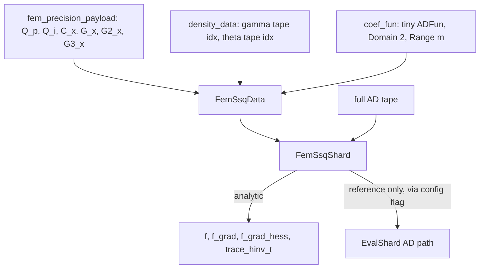

# Analytic derivatives for the FEM `random_fem_ssq` term

## Overview

Replace the CppAD tape sweeps for the FEM quadratic form `-0.5 * gamma' Q(theta) gamma`
with closed-form derivatives, implemented as a custom `ad_shard` inside `adlaplaceFem`.
The tape stays built so the AD path remains available as a reference oracle.

## Diagnosis

`random_fem_ssq` puts every nonzero of Q on the AD tape:

```194:203:adlaplaceFem/src/ad_pack_random_fem.cpp
  CppAD::AD<double> qf = 0.0;
  for (std::size_t col = 0; col < n; ++col) {
    for (int pos = pay.Q_p[col]; pos < pay.Q_p[col + 1]; ++pos) {
```

Three consumers then sweep that tape repeatedly:

- `f_grad`: 1 reverse sweep. Not a problem.
- `f_grad_hess`: one forward plus one reverse sweep **per color**. The color count is the
  distance-2 chromatic number of Q's graph, in the hundreds for this stencil.
- `trace_hinv_t`: `Forward(0)`, `Forward(1)`, `Forward(2)`, `Reverse(3)` **per assigned
  column**, and `trace_columns_from_pattern` assigns this shard every gamma column. This is
  probably the single largest cost in the fit, larger than the Hessian coloring.

### The sparsity pattern is already specified

`random_fem_ssq_sparsity` builds the analytic Hessian pattern and
`build_ad_fun_random_with_pattern` feeds it through `adpack_sparsity` into
`sparse_hes(..., "cppad.symmetric", ...)`. That lever is fully pulled; there is no further
speedup available there.

### The dense theta rows are not the problem either

`random_fem_ssq_sparsity` couples both thetas to every gamma, making two dense rows. Reading
`color_symmetric_cppad` in [RCppAD/inst/include/cppad/local/color_symmetric.hpp](RCppAD/inst/include/cppad/local/color_symmetric.hpp),
rows are ordered descending by number of pairs needed, so the two theta rows are colored
first, and the pruning step at lines 177-190 removes them from every gamma's `pair_needed`
before any gamma row is colored. They therefore cost about two extra colors, not 4176.

### Why AD is the wrong tool here

Q is a *linear* combination of *constant* Gram matrices whose m = 3 or 4 scalar coefficients
depend only on the two thetas:

- `Q(theta) = sum_j c_j(theta) * M_j`, with `M = (C, G, G2, [G3])`
- `f = -0.5 * gamma' Q(theta) gamma`

Every derivative is closed form:

- `df/dgamma = -Q gamma`
- `df/dtheta_k = -0.5 * sum_j c'_jk * (gamma' M_j gamma)`
- `H[gamma,gamma] = -Q`, which is exactly the `Q_x` values the tape already assembles
- `H[gamma,theta_k] = -(dQ/dtheta_k) gamma`
- `H[theta_j,theta_k] = -0.5 * sum_l c''_ljk * (gamma' M_l gamma)`

For `trace_hinv_t` the direction vector is scattered only into gamma slots
(`idx = gp.gamma_row_to_tape[row]`, [adlaplace/inst/include/adlaplace/eval_impl.hpp](adlaplace/inst/include/adlaplace/eval_impl.hpp) line 438),
so `v_theta = 0` and the order-2 Taylor coefficient is `-0.5 * v' Q(theta) v`. Its gradient is
**identically zero on every gamma coordinate**, leaving two numbers:

- `out_trace[theta_k] = -0.5 * sum_cols v' (dQ/dtheta_k) v`

Only first derivatives of the coefficients are needed, and only two accumulated quadratic
forms per column instead of four full tape sweeps.

## Approach

`ad_shard` is a virtual interface and the shard class is injected by a `ShardFactory` that
`adlaplaceFem` already owns via `ADLAPLACE_DEFINE_BACKEND(adlaplace_fem_make_shard)` in
[adlaplaceFem/src/backend.cpp](adlaplaceFem/src/backend.cpp). The whole change is contained
within `adlaplaceFem`: no changes to `adlaplace`, no ABI bump.



## Steps

### 1. Factor the coefficient map out of `fem_kappa_tau2`

In [adlaplaceFem/src/ad_pack_random_fem.cpp](adlaplaceFem/src/ad_pack_random_fem.cpp),
extract a template helper taking the two raw theta scalars plus the two
`transform_theta_at` flags and returning the m coefficients. Both `assemble_Q_x` and the new
tiny coefficient tape then call identical code, so the formulas cannot drift.
`fem_kappa_tau2` becomes a thin wrapper that pulls `x[theta_index(0)]`, `x[theta_index(1)]`
and delegates.

### 2. New header `adlaplaceFem/src/fem_ssq_analytic.hpp`

`struct FemSsqData` plus the pure math, with no dependency on `eval_impl.hpp`:

- the payload arrays plus symmetry weights `w_k` (1 diagonal, 2 off-diagonal), mirroring the
  existing `register_fem_logdet_payload`
- `gidx` (gamma row to tape index) and the two theta tape indices, captured from
  `density_data` at build time
- a `CppAD::ADFun<double>` with Domain 2 and Range m recorded from step 1's helper, giving
  `c_j` and `dc_j/dtheta_k` via `Jacobian` and `d2c_j/dtheta_j dtheta_k` via m tiny `Hessian`
  calls. Third derivatives are not needed. Using a tiny tape here avoids hand-differentiating
  the range/sd to kappa/tau map together with the optional log transform.
- primitives over the upper-triangle CSC: `sym_matvec` (`y[row] += M[k]*x[col]`, plus the
  mirrored write when `row != col`), and a fused `sym_quad` computing several `x' M_j x` in a
  single pass
- a support-restricted `sym_quad` for `trace_hinv_t`: stamp `supp(v)`, then loop
  `col in supp(v)` and take entries whose row is stamped, so cost is
  `O(sum_{col in supp} nnz(Q col))` rather than `O(nnz(Q))` per column

### 3. New header `adlaplaceFem/src/fem_ssq_shard.hpp`

`class FemSsqShard : public EvalShard`, included only from
[adlaplaceFem/src/backend.cpp](adlaplaceFem/src/backend.cpp) after `eval_impl.hpp` (which
must appear in exactly one translation unit per DSO). It inherits `get_sizes`,
`get_sparse_pattern`, and `assign_memory` unchanged, and overrides `f`, `f_grad`,
`f_grad_hess`, `trace_hinv_t`, and `clone`.

At construction, build slot maps by reading `pack.pattern_grad`, `pattern_grad_inner`,
`pattern_hessian`, and `pattern_hessian_inner` directly, classifying each nnz as a Q entry
position, a `(gamma, theta_k)` cross entry, or a `(theta_j, theta_k)` entry. Reading the
patterns from the pack makes the nnz ordering correct by construction, rather than assuming
the `std::set` ordering used in `random_fem_ssq_sparsity`.

Per evaluation, assemble `Q_x = sum_j c_j M_j[k]` and `dQk_x = sum_j c'_jk M_j[k]` once
(`O(m * nnz)`), then fill from the maps.

Two details must match `EvalShard` exactly:

- `out_f` and `out_grad` are **accumulated** with `+=`
- `out_hes[map[Di]]` is **assigned** with `=` (`eval_impl.hpp` line 277), so structurally
  present entries whose analytic value is zero must be written as explicit zeros, not skipped

### 4. Explicit construction path, no global mutable state

`packs_to_ad_fun` fixes the factory signature to `ad_shard*(AdTape&&)`, which cannot carry
the payload. Rather than a pending-payload registry, export from `backend.cpp`:

```cpp
ADLAPLACE_EXTENSION_EXPORT ad_pack* fem_ssq_packs_to_ad_fun(
    std::vector<AdTape>&& packs, std::size_t n_beta, std::size_t n_theta,
    std::shared_ptr<const FemSsqData> data);
```

`create_ad_shard_random_fem_ssq<Alpha>` declares it `extern` (as it already does for
`adlaplace_fem_make_shard`) and calls it instead of `packs_to_ad_fun`. `clone` copies the
`shared_ptr`.

### 5. Config escape hatch for verification

Have `create_ad_shard_random_fem_ssq<Alpha>` read a `config` flag (default analytic) and fall
back to `packs_to_ad_fun(..., adlaplace_fem_make_shard)` when off, so tests can build both
shards from the same model and compare.

### 6. New test `adlaplaceFem/tests/testthat/test-fem-ssq-analytic.R`

Following the end-to-end setup in
[adlaplaceFem/tests/testthat/test-random-fem.R](adlaplaceFem/tests/testthat/test-random-fem.R),
build both shards on a small FEM model and compare `joint_log_dens`, `grad` (inner and
outer), and `hessian` (inner and outer) to tight tolerance, crossing alpha 2 and 3 with
`transform_theta` TRUE and FALSE.

For `trace_hinv_t`, follow the pattern at
[adlaplace/tests/testthat/test-trace-columns.R](adlaplace/tests/testthat/test-trace-columns.R)
line 145 (`ad_pack`, then `inner_opt(deriv = TRUE)`, passing `io$hessian$half_H_inv` and
`af@chol_inner_list$trace_columns`), and additionally assert the analytic result is exactly
zero on all gamma coordinates.

### 7. Verify and time

Confirm the existing finite-difference checks in `test-random-fem.R` still pass now that they
exercise the analytic path, then time `hessian()` and `inner_opt(deriv = TRUE)` on the loaloa
configuration to quantify the improvement.

## Expected effect and what this does not fix

Per-call cost for this term drops from hundreds of tape sweeps (Hessian) and thousands
(trace) to a handful of `O(nnz(Q))` passes.

Deliberately out of scope: the one-time `sparse_hes` coloring inside `adpack_sparsity`
([adlaplace/inst/include/adlaplace/ad_pack.hpp](adlaplace/inst/include/adlaplace/ad_pack.hpp)
line 261), which is almost certainly the "many minutes with no output" pause before `optim()`
starts. Removing that requires constructing the patterns without the calibration sweeps and
skipping the tape entirely. That is the follow-up, deferred until the analytic formulas are
verified against AD.
