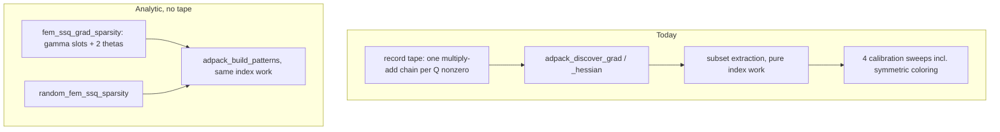

# Skip the tape and the build-time coloring for `random_fem_ssq`

## Overview

The analytic ssq shard never sweeps its tape, yet `adpack_sparsity` still records
the tape and runs four calibration sweeps (including the `cppad.symmetric`
Hessian coloring) at build time. That is the setup pause before `optim()` starts.
Split `adpack_sparsity` into a pattern half and a calibration half, and build the
analytic pack from the pattern half alone with `AdTape::fun` left empty.

## Why this is safe

Outside `EvalShard`, only two shared paths touch `AdTape::fun`, and both are
fine on a default-constructed tape:

- `clone_group_pack` does `dst.fun = src.fun`
  ([adlaplace/inst/include/adlaplace/backend.hpp](adlaplace/inst/include/adlaplace/backend.hpp)
  line 88). `ADFun` copy-assignment handles an empty source.
- `adlaplace_release_shard_eval_buffers` calls `gp.fun.capacity_order(0)`
  ([adlaplace/src/runtime.cpp](adlaplace/src/runtime.cpp) lines 15-21) at every
  parallel scope boundary. With an empty tape this clears an empty buffer.

Everything else that drives shards (`eval_derivs.cpp`, `inner_opt.cpp`,
`trustoptim.hpp`, `trace_hinv_t_runtime.hpp`) goes through the `ad_shard`
virtuals only. Note that `ad_pack::fun` is a `std::vector<ad_shard*>`, unrelated
to `AdTape::fun`; most matches for `.fun` are that vector.

The `work_grad` / `work_inner_grad` / `work_hess` / `work_inner_hess` objects are
referenced only by `adpack_sparsity` and `EvalShard`, so the analytic shard needs
none of them.

Of the things `adpack_sparsity` produces, only one is genuinely tape-derived:

- `adpack_attach_tape_maps` (ad_pack.hpp lines 80-90) needs no tape.
- `adpack_fill_global_patterns` needs no tape; it reads the pattern structure,
  which is assigned before the sweeps (the sweeps only fill values).
- The Hessian pattern is already analytic, via `random_fem_ssq_sparsity`.
- `pattern_grad` comes from `adpack_discover_grad`'s `for_jac_sparsity`, so it is
  the one thing that has to be constructed by hand.

No `AdTape` field is added, so `ADLAPLACE_ABI_VERSION` stays at 3.



## Steps

### 1. Split `adpack_sparsity` in adlaplace

In [adlaplace/inst/include/adlaplace/ad_pack.hpp](adlaplace/inst/include/adlaplace/ad_pack.hpp),
carve the existing body (lines 143-271) into two halves with no behaviour change.

Add a small carrier for the four patterns the calibration sweeps need as their
`pattern` arguments:

```cpp
struct AdpackPatterns {
  CppAD::sparse_rc<CPPAD_TESTVECTOR(size_t)> grad;
  CppAD::sparse_rc<CPPAD_TESTVECTOR(size_t)> grad_inner;
  CppAD::sparse_rc<CPPAD_TESTVECTOR(size_t)> hessian;        // both triangles
  CppAD::sparse_rc<CPPAD_TESTVECTOR(size_t)> hessian_inner;  // both triangles
};
```

- `adpack_build_patterns(gp, n_params, subset, grad, hessian_full, verbose)`,
  returning `AdpackPatterns`. Moves lines 167-260's structural work: sets `gp.w`,
  `gp.x`, the `insubset` mask, the `grad_inner` / `hessian_upper` /
  `hessian_inner` / `hessian_inner_upper` extraction, the four
  `gp.pattern_*` assignments, and the `adpack_fill_global_patterns(gp)` call.
  Touches no tape.
- `adpack_calibrate(x, gp, pats)`: the `gp.fun.Forward(0, x)` plus the two
  `sparse_jac_rev` and two `sparse_hes` calls. Requires a recorded tape.
- `adpack_sparsity` keeps its current signature and becomes discover, then
  `adpack_build_patterns`, then `adpack_calibrate`, so every existing caller
  (`build_ad_fun_random`, `build_ad_fun_obs`, `build_ad_fun_parameters`) is
  unaffected.

This is header-only, but `adlaplace` and `adlaplaceExample` compile these headers
and must be reinstalled alongside `adlaplaceFem`.

### 2. Analytic gradient pattern

In [adlaplaceFem/src/ad_pack_random_fem.cpp](adlaplaceFem/src/ad_pack_random_fem.cpp),
add `fem_ssq_grad_sparsity(model)` returning a 1 by `n_tape` `sparse_rc` holding
every gamma tape slot plus the two theta slots, emitted in ascending column
order to match what `for_jac_sparsity` produces. Q has a full diagonal, so every
gamma is structurally present in the gradient.

### 3. Build the pack without a tape

Add `build_fem_ssq_pack` in the same file:

```cpp
template <int Alpha>
AdTape build_fem_ssq_pack(density_data model, const Config &cfg, bool verbose) {
  model.apply_tape_domain(cfg, "all", 0);
  AdTape pack;                     // pack.fun stays default-constructed
  pack.owner_thread_assigned = false;
  adpack_attach_tape_maps(pack, model);
  adpack_build_patterns(pack, model.n_tape, model.seq_gamma,
                        fem_ssq_grad_sparsity(model),
                        random_fem_ssq_sparsity(model), verbose);
  return pack;
}
```

`adpack_build_patterns` sizes `pack.x`, which becomes the shard's size of truth.

### 4. Stop using the tape as a size gate

[adlaplaceFem/src/fem_ssq_shard.hpp](adlaplaceFem/src/fem_ssq_shard.hpp) reads
`pack.fun.Domain()` in five places (lines 29, 41, 55, 118, 147-148, 274). Replace
each with `pack.x.size()`, which `adpack_build_patterns` sets in both the taped
and untaped paths. This avoids adding an `AdTape` field and keeps the shard
working unchanged in taped mode.

### 5. Three modes

`create_ad_shard_random_fem_ssq<Alpha>` gains a second config flag:

- `fem_analytic = TRUE` (default), `fem_tape = FALSE` (default): analytic
  evaluation, no tape recorded. New default.
- `fem_analytic = TRUE`, `fem_tape = TRUE`: analytic evaluation over a recorded
  and calibrated tape. Lets the tests compare the hand-built `pattern_grad`
  against the tape-discovered one and A/B the build cost.
- `fem_analytic = FALSE`: the existing AD path, tape forced on.

### 6. Tests

Extend
[adlaplaceFem/tests/testthat/test-fem-ssq-analytic.R](adlaplaceFem/tests/testthat/test-fem-ssq-analytic.R):

- The hand-built patterns equal the tape-discovered ones. Build no-tape analytic
  and taped analytic packs and compare `adlaplace:::pack_sizes` /
  `get_sparse_pattern` output (gradient inner and outer, Hessian inner and outer
  rows and columns) for exact equality. This is the load-bearing assertion, since
  `trace_columns_from_pattern` and the R-side Hessian template are both derived
  from `grad_inner`.
- All three modes agree on `joint_log_dens`, `grad`, `hessian` (inner and outer),
  and `trace_hinv_t`, across alpha 2 and 3 crossed with `transform_theta`.
- The no-tape pack survives a clone and a parallel scope: build with
  `num_threads = 2L` and run `fun_obj_fdfh`, exercising `clone_group_pattern`
  copy-assign of the empty `ADFun` and `capacity_order(0)`.

### 7. Measure

Time pack construction for all three modes on the large loaloa configuration
(`cells = 6`, `buffer = 300 km`, `fact = c(2, 4)`, `degree = 3`) to attribute the
pause between taping and coloring, and confirm the no-tape build is fast.
Report peak memory too, since the tape held roughly one multiply-add chain per Q
nonzero.

## Known cosmetic consequence

`get_tape_sizes` ([adlaplace/src/ad_pack_create.cpp](adlaplace/src/ad_pack_create.cpp)
lines 141-145) reads `fun.Domain()`, `size_op()`, and `size_var()`, so it will
report zeros for a no-tape shard. It is a diagnostic only; nothing downstream
consumes it. Worth a note in the `fem_tape` documentation so the zeros are not
mistaken for a broken pack.
