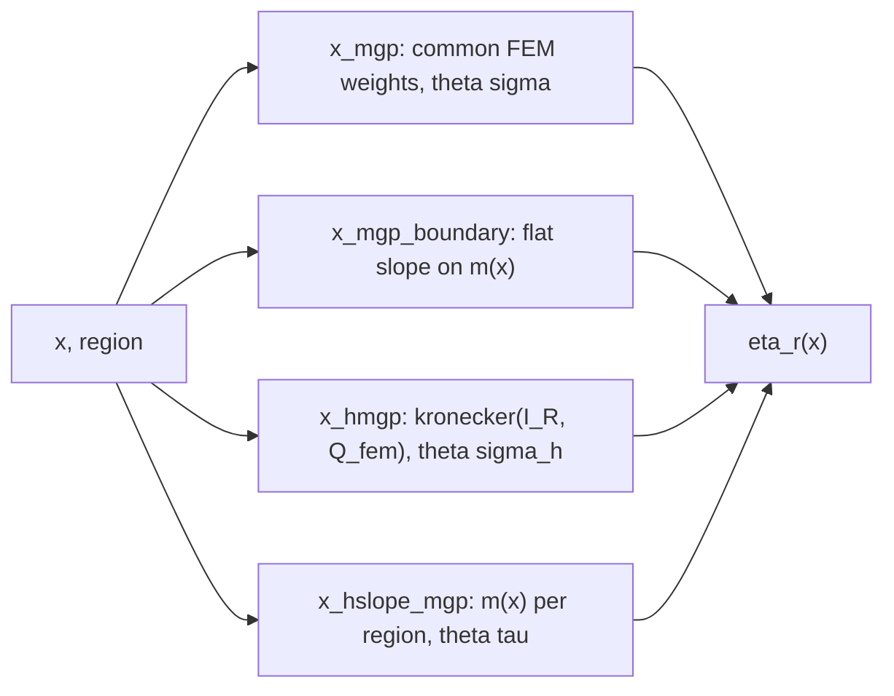

# Grouped mGP (`hmgp`) in adlaplaceFem

## Why

The healthcanada AQHI document fits, per pollutant \(p\) and region \(r\),

\[
\eta_{r}(x) = f_p(x) + \beta_p\, m_p(x) + h_{pr}(x) + \beta_{pr}\, m_p(x)
\]

- \(f_p \sim\) mGP\((a=2, \sigma_p)\) with the flat boundary slope \(\beta_p\) on the Box-Cox column \(m_p(x)\): this is the existing `mgp()`.
- \(h_{pr} \sim\) mGP\((a=2, \sigma^h_p)\), independent across the four regions, one shared \(\sigma^h_p\).
- \(\beta_{pr} \sim N(0, \tau_p^2)\) iid across regions, \(\tau_p\) estimated.

The last two components do not exist. The document will call `c(adlaplaceFem::mgp(pol, ...), adlaplaceFem::hmgp(pol, ..., by = "region", levels = regions), ...)` inside `adlaplace::adlaplace()` with a `dirichlet_multinom` response, then evaluate `adlaplace::design(term, newx)` on a grid with a `region` column and multiply by `canrisk::sample_gamma()` draws (row names are gamma labels). Everything below has to keep that workflow working.

## What exists (read these first)

- `adlaplaceFem/R/mgp.R`: `mgp()` returns `list(<x>_mgp, <x>_mgp_boundary)`. `mgp` is `density = "random_mult"`, `package = "adlaplace"`, fixed FEM precision from `term@fem` (`Q`, `log_det`, `rank`), one SD theta labelled `<x>_mgp`. `random_info` hard-codes `by = NA`. `mgp_boundary` is a single Box-Cox column, `random_diagonal`, flat when `sd = Inf` (no theta, `precision` returns `NULL`).
- `adlaplaceFem/R/mgp-fem.R`: `mgp_fem()`, `mgp_fem_design()`, `mgp_boxcox()`, `mgp_reference()`, `mgp_check_domain()`. Reuse, do not re-derive.
- `adlaplaceFem/R/matern1d.R`: `rsmatern` is the in-package template for a `by` term: `by = "by_group"` slot, `.rsmatern_levels()` (levels from the term, else from the data), block design by scattering B-spline columns per level (`col_out <- cols + (reg[rows + 1L] - 1L) * nb`), `kronecker(eye, C)` precision, `random_info` with `by`/`by_labels` ordered level-major, gamma labels `<label>_<lv>_b##`.
- `adlaplaceHgp/R/hiwp.R`, `hrpoly.R`: the global + per-group pattern (`include_global`), gamma labels `_k##_g<lv>`, `adlaplace:::add_by_levels()`.
- `adlaplace/R/iid.R`: `random_diagonal` with identity precision and one estimated SD theta: the model for the per-group slope.
- `adlaplace/R/model_data.R` line 189, `theta_map_for_term()`: thetas are attached to a random shard by an **unanchored** `grep(term@label, theta_info$label)`. A term label that is a substring of another term's theta label pulls in the wrong theta. `rsmatern` relies on this prefix behaviour for its `_range` / `_sd` thetas, so do not change it; choose labels that cannot collide instead.
- `adlaplace/R/density_data.R`: `normalize_random_mult_precision()` wants `Q` symmetric sparse; `random_mult` C++ checks `ncol(Q)` equals the shard's gamma count.

## Design

Two new classes in `adlaplaceFem/R/hmgp.R`, one constructor.



### Labels

- Curve deviation term and its theta: `<x>_hmgp`. Gamma labels `<x>_hmgp_k##_g<lv>` (basis fastest within level, same order as the design blocks).
- Slope deviation term and its theta: `<x>_hslope_mgp`. Gamma labels `<x>_hslope_mgp_g<lv>`.
- Rule: `<x>_mgp` must not be a substring of any new label, and `<x>_hmgp` must not be a substring of `<x>_hslope_mgp`. These names satisfy both (`pm_mgp` is not inside `pm_hmgp` or `pm_hslope_mgp`; `pm_hmgp` is not inside `pm_hslope_mgp`). Keep a test for this.

### Classes

```r
setClass("hmgp", slots = list(by = "by_group"), contains = "mgp",
  prototype = prototype(by = adlaplace::by_group()))

setClass("hmgp_boundary", slots = list(by = "by_group"), contains = "mgp_boundary",
  prototype = prototype(by = adlaplace::by_group(), sd = NA_real_))
```

`hmgp_boundary` uses the inherited `init / lower / upper / parscale / log` slots for its theta (the parent `mgp_boundary` never sets them).

### Constructor

```r
hmgp <- function(
  x, a = 2, knots, ref_value = "left", by, levels = NULL, n_quad = 10,
  init = 0.02, lower = 1e-9, upper = Inf, parscale = 1, log = TRUE,
  slope_init = 0.02, slope_lower = 1e-9, slope_upper = Inf, slope_parscale = 1, slope_log = TRUE,
  include_global = FALSE, boundary_sd = Inf)
```

- Validate `knots`, `a`, `n_quad`, reference exactly as `mgp()` does. Factor the shared checks into an internal `.mgp_validate(x, a, knots, ref_value, n_quad)` returning `list(x, a, knots, x0, cs, fem)` and have both `mgp()` and `hmgp()` call it (no copy-paste).
- `by <- adlaplace::by_group(term = as.character(by), levels = levels)`.
- Returns a named list: `<x>_hmgp`, `<x>_hslope_mgp`; when `include_global = TRUE`, also the two terms from `mgp(x, a, knots, ref_value, boundary_sd, n_quad, init, lower, upper, parscale, log)` so one call gives common plus deviation.

### Internal helpers

- `.hmgp_levels(term, data)`: as `.rsmatern_levels`.
- `.hmgp_group_index(term, data, levels)`: `match(as.character(data[[by]]), levels)`, error listing unknown levels.
- `.hmgp_scatter(B, group, n_levels, colnames)`: sparse block scatter (lift the logic from `rsmatern`'s `design`; `rsmatern` may keep its inline copy or switch to the helper, either is fine).
- `.hmgp_gamma_labels(term, levels, n)`: `paste0(term@label, "_k", pad, "_g", lv)`.

### Methods: `hmgp`

- `design(term, data)`: same column presence, finiteness, and knot-range checks as `mgp`; `B <- mgp_fem_design(x, term@fem)`; scatter by group; colnames from the helper. Must work on prediction data that contains only `x` and the `by` column.
- `precision(term, data)`: `R <- length(levels)`; `list(Q = as(kronecker(Diagonal(R), term@fem$Q), "dgCMatrix"), log_det = R * term@fem$log_det, rank = R * as.integer(term@fem$rank))`.
- `theta_info`: one row, `model = "hmgp"`, `label = term@label`.
- `random_info`: `expand.grid(basis = seq_len(rank), by = levels)` reordered level-major; `by_labels`; `order = 2L`; `gamma_label` from the helper; must equal `colnames(design())` in order.
- `beta_info`: `NULL`. `extra_density`: `NULL`.
- `replace_vars`: `callNextMethod`, rename `by@term` if in `map`, `label <- paste(name, "hmgp", sep = "_")`.
- `psd`: inherited from `mgp` is correct for the deviation (same operator); no override needed.

### Methods: `hmgp_boundary`

- `design`: `m <- mgp_boxcox(x - term@ref_value, a = term@a, cs = term@shift)`; scatter into `R` columns `paste0(term@label, "_g", lv)`.
- `precision`: `Matrix::Diagonal(R, 1)` with dimnames set to the gamma labels (identity; the SD enters through theta, as in `iid`).
- `theta_info`: one row, `model = "hmgp_boundary"`, `label = term@label`, `init/lower/upper/parscale/log` from the slope controls.
- `random_info`: `R` rows, `basis = NA`, `by`, `by_labels`, `order = 1L`, gamma labels matching the design.
- `replace_vars`: `label <- paste(name, "hslope_mgp", sep = "_")`.

## Package metadata

- `adlaplaceFem/DESCRIPTION`: add `hmgp.R` to `Collate` after `mgp.R`; bump version (currently 0.7.3).
- Roxygen: `@export hmgp`, `@exportClass hmgp hmgp_boundary`, `@exportMethod` for every method above (NAMESPACE is generated by `make adlaplaceFem`).
- Add `@seealso` from the `mgp-class` docs to `hmgp`, and a short paragraph in `mgp.R`'s roxygen describing the grouped version.

## Tests: `adlaplaceFem/tests/testthat/test-hmgp.R`

- Constructor: two terms with the expected names; four with `include_global = TRUE`; errors on missing `by`, bad knots, unknown level at design time.
- Design: on data with levels `A`, `B`, `design(hmgp)` restricted to `A` rows and `A` columns equals `design(mgp_term, data[A rows])`; the `B` block for those rows is all zero.
- Precision: `Q` equals `bdiag(Q_fem, Q_fem)`; `log_det` and `rank` scale by `R`.
- `random_info()$gamma_label` identical to `colnames(design())`; `theta_info()` one row per term.
- Label uniqueness: for `terms <- c(mgp(...), hmgp(...))`, with `labs <- unlist(lapply(terms, function(t) theta_info(t)$label))`, every `grep(t@label, labs)` has length 1.
- Boundary: `design(hmgp_boundary)` columns equal `design(mgp_boundary)` masked by group; `precision` is the identity with the right dimnames.
- End to end: simulate a small two-group case-crossover (follow the `dirichlet_multinom` + `mgp` test near `test-mgp.R` lines 195-198), fit `c(dm, mgp(...), hmgp(...), iwp(...))` with a handful of outer iterations and `hessian = TRUE`; assert `par_info$label` contains `x_mgp`, `x_hmgp`, `x_hslope_mgp`, that `fit$gamma` names cover every `hmgp` and `hslope` gamma label, and that `fit$details$hessian$half_H_inv` is non-null.
- `replace_vars`: renaming `x` and `by` updates `name`, `by@term`, `label`, and the design colnames consistently.
- Keep the E2E test short enough for `R CMD check` (small knot set, few strata, `maxit` around 5).

## Install and smoke test

```sh
cd /home/patrick/research/adlaplace && make adlaplaceFem
Rscript -e 'library(adlaplaceFem); args(hmgp)'
```

Then from `/home/patrick/research/healthcanada`, build a toy data frame with `pm` in the knot range and `region` in four levels and check `adlaplace::design(hmgp(...)[[1]], toy)` has `4 * rank` columns.

## Out of scope

- Anchoring `theta_map_for_term()` in adlaplace (would break `rsmatern`'s prefix-matched `_range` / `_sd` thetas).
- A PC prior (`psd_prior`) for the deviation SDs.
- Grouped Matern or IWP FEM variants; `hiwp` in adlaplaceHgp already covers grouped IWP.
- Any change to `adlaplace` or `adlaplaceHgp`.
